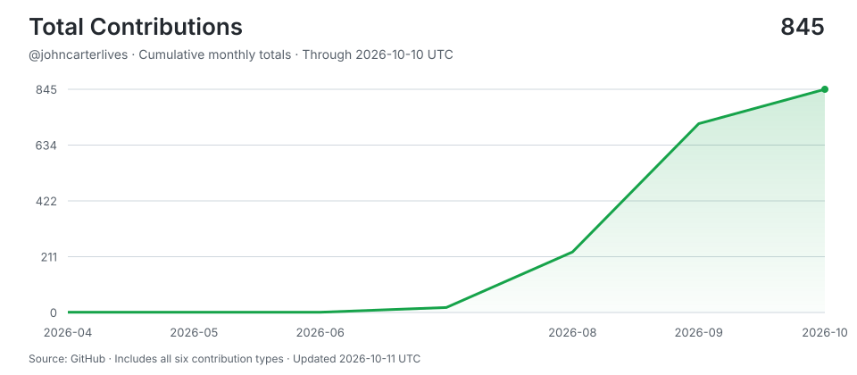

# johncarterlives

> Shipping with AI agents around the clock -- human hours for thinking, machine hours for doing.
>
> Stats auto-updated by [aidevops](https://aidevops.sh).

<!-- STATS-START -->
## Work with AI

| Metric | Yesterday | Prior 7 Days | Prior 28 Days | Prior 365 Days |
| --- | ---: | ---: | ---: | ---: |
| Screen time (Mac) | 6.1h | 104h | 186.2h | ~2547h* |
| Interactive human attention | 3.0h | 44.0h | 133.5h | 304.9h |
| Interactive AI generation | 7.5h | 105.5h | 307.0h | 649.7h |
| Worker-classified human attention | 0.0h | 2.7h | 96.1h | 121.4h |
| Worker/headless AI generation | 1.4h | 27.2h | 91.6h | 207.5h |
| Additive observed work | 12.0h | 177.7h | 601.2h | 1,244.3h |
| Interactive sessions | 22 | 113 | 308 | 657 |
| Worker sessions | 153 | 1,244 | 3,489 | 4,902 |

_Screen time from screen-time-history:daily-observations; collection status: ok. *365-day estimate uses observed calendar coverage._

_Periods are completed local calendar days ending at midnight; today is excluded._

_Human attention is unioned wall-clock time, so overlapping sessions are not double-counted. AI generation is additive machine work across sessions; it is not wall-clock concurrency._

_AI session 365-day totals cover 188 days of local assistant session history (not extrapolated)._

## AI Model Usage (last 30 days)

| Model | Requests | Input | Output | Cache read | Cache write | Cache Hit-Rate % | Session Count | Session Hours |
| --- | ---: | ---: | ---: | ---: | ---: | ---: | ---: | ---: |
| gpt-5.6-sol | 22,355 | 93.7M | 5.1M | 3,264.9M | 0 | 97.2% | 173 | 179.8h |
| gpt-6.1-sol | 20,028 | 104.2M | 4.5M | 2,302.5M | 0 | 95.7% | 779 | 135.1h |
| gpt-5.6-terra | 6,932 | 195.9M | 1.2M | 494.4M | 0 | 71.6% | 746 | 23.9h |
| gpt-6-luna | 5,477 | 126.3M | 1.1M | 416.6M | 0 | 76.7% | 1,574 | 19.7h |
| gpt-6.1-sol-fast | 3,973 | 15.1M | 1.1M | 614.9M | 0 | 97.6% | 19 | 39.3h |
| gpt-6-astra | 3,587 | 28.9M | 1.3M | 610.6M | 0 | 95.5% | 199 | 45.0h |
| gpt-6-sol | 2,932 | 26.4M | 433K | 233.1M | 0 | 89.8% | 287 | 14.5h |
| gpt-5.6-luna | 655 | 20.6M | 81K | 49.9M | 0 | 70.8% | 239 | 1.8h |
| muse-spark-1.3-contributor-free | 19 | 583K | 13K | 2.3M | 0 | 79.9% | 1 | 0.1h |
| **Total** | **65,958** | **612.1M** | **15.3M** | **7,989.7M** | **0** | **92.9%** | **3,881** | **459.2h** |

_8,617.1M total tokens processed. 92.9% cache hit rate._

## AI Model Usage (all time)

| Model | Requests | Input | Output | Cache read | Cache write | Cache Hit-Rate % | Session Count | Session Hours |
| --- | ---: | ---: | ---: | ---: | ---: | ---: | ---: | ---: |
| gpt-5.6-sol | 54,086 | 245.8M | 12.5M | 7,425.8M | 0 | 96.8% | 519 | 440.4h |
| gpt-6.1-sol | 20,028 | 104.2M | 4.5M | 2,302.5M | 0 | 95.7% | 779 | 135.1h |
| gpt-5.6-terra | 16,886 | 284.7M | 3.0M | 1,283.6M | 0 | 81.8% | 1,615 | 58.0h |
| gpt-6-astra | 7,423 | 43.2M | 2.3M | 1,322.0M | 0 | 96.8% | 231 | 83.9h |
| gpt-5.5 | 7,076 | 45.3M | 2.0M | 717.6M | 0 | 94.1% | 127 | 33.4h |
| gpt-6-luna | 5,477 | 126.3M | 1.1M | 416.6M | 0 | 76.7% | 1,574 | 19.7h |
| gpt-6.1-sol-fast | 3,973 | 15.1M | 1.1M | 614.9M | 0 | 97.6% | 19 | 39.3h |
| gpt-6-sol | 2,932 | 26.4M | 433K | 233.1M | 0 | 89.8% | 287 | 14.5h |
| gpt-5.6-luna | 2,137 | 45.5M | 522K | 181.2M | 0 | 79.9% | 466 | 31.7h |
| gemma4:26b-mlx | 82 | 4.1M | 26K | 0 | 0 | 0.0% | 5 | 1.1h |
| muse-spark-1.3-contributor-free | 63 | 906K | 23K | 7.6M | 0 | 89.4% | 3 | 0.2h |
| big-pickle | 44 | 257K | 15K | 3.0M | 0 | 92.3% | 3 | 0.2h |
| qwen3.8-flash | 22 | 87K | 2K | 1.3M | 0 | 93.9% | 1 | 0.1h |
| gemma4-agent | 17 | 314K | 4K | 0 | 0 | 0.0% | 2 | 0.1h |
| Qwen3.8-27B-oQ6e-mtp:qwen38-q6-stable | 7 | 63K | 1K | 249K | 0 | 79.7% | 1 | 0.3h |
| gemma4-agent-mlx:latest | 6 | 170K | 3K | 0 | 0 | 0.0% | 2 | 0.1h |
| mtplx-qwen38-27b-optimized-quality | 1 | 0 | 0 | 0 | 0 | 0.0% | 1 | 0.0h |
| nemotron-3.5-lightning-30b-a3b | 1 | 49K | 107 | 0 | 0 | 0.0% | 1 | 0.0h |
| qwen/qwen3.8-flash | 1 | 0 | 0 | 0 | 0 | 0.0% | 1 | 0.0h |
| **Total** | **120,262** | **942.9M** | **27.9M** | **14,510.2M** | **0** | **93.9%** | **5,448** | **858.1h** |

_15,481.0M total tokens processed. 93.9% cache hit rate._
<!-- STATS-END -->

<!-- CONTRIBUTIONS-START -->
## Contributions

- **[aidevops](https://github.com/marcusquinn/aidevops)** -- Vibe-Coding is easy. DevOps is hard. OpenCode & Git token-efficient AI agent automation for your app, business, and personal development. Opinionated tools, services, CLI & API stack for speed, security, and 24/7 results. Open-source first. SOTA everything. Try on your repos for money-making magic.
- **[playwriter](https://github.com/remorses/playwriter)** -- Chrome extension & CLI to let agents control your browser. Runs Playwright snippets in a stateful sandbox. Available as CLI or MCP
<!-- CONTRIBUTIONS-END -->

## Connect

---

<!-- UPDATED-START -->
_Stats auto-updated 2026-10-13 16:10 UTC by [aidevops](https://aidevops.sh) pulse._
<!-- UPDATED-END -->

<!-- TOTAL-CONTRIBUTIONS-START -->

  <a href="https://commit-history.com/johncarterlives?metric=total" target="_blank" rel="noopener noreferrer">
    <picture>
      <source media="(prefers-color-scheme: dark)" srcset="assets/contributions/total-dark.svg" />
      
    </picture>
  </a>

[Verify on commit-history.com](https://commit-history.com/johncarterlives?metric=total) · [Chart data](assets/contributions/total.json)

Includes commits, issues, pull requests, reviews, repositories, and restricted contributions. Refreshed daily through the prior UTC day; commit-history.com may use a different refresh cutoff. GitHub controls link navigation—Ctrl/Cmd-click opens verification in a new tab.
<!-- TOTAL-CONTRIBUTIONS-END -->
