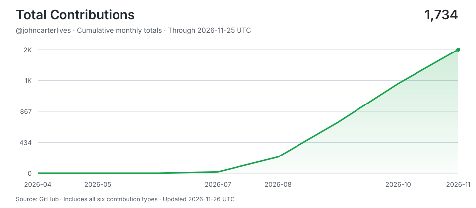

# johncarterlives

> Shipping with AI agents around the clock -- human hours for thinking, machine hours for doing.
>
> Stats auto-updated by [aidevops](https://aidevops.sh).

<!-- STATS-START -->
## Work with AI

| Metric | Yesterday | Prior 7 Days | Prior 28 Days | Prior 365 Days |
| --- | ---: | ---: | ---: | ---: |
| Screen time (Mac) | 0.4h | 27.9h | 313.1h | ~3529h* |
| Input activity (Mac) | unavailable | unavailable | unavailable | unavailable |
| Interactive human attention | 0.0h | 25.4h | 99.1h | 518.2h |
| Interactive AI generation | 48.0h | 187.3h | 350.3h | 1283.9h |
| Worker-classified human attention | 0.0h | 0.0h | 0.3h | 128.8h |
| Worker/headless AI generation | 0.0h | 8.0h | 49.9h | 336.3h |
| Additive observed work | 48.0h | 220.7h | 499.5h | 2,224.3h |
| Interactive sessions | 14 | 135 | 1,335 | 2,172 |
| Worker sessions | 4 | 245 | 2,636 | 10,327 |

_Screen time from screen-time-history:daily-observations; collection status: ok. *365-day estimate uses observed calendar coverage._

_Input activity from macos-input-activity (time from each keyboard, mouse or trackpad input until 5 idle minutes); collection status: unavailable (no-input-activity-samples)._

_Periods are completed local calendar days ending at midnight; today is excluded._

_Human attention is unioned wall-clock time, so overlapping sessions are not double-counted. AI generation is additive machine work across sessions; it is not wall-clock concurrency._

_AI session 365-day totals cover 234 days of local assistant session history (not extrapolated)._

## AI Model Usage (last 30 days)

| Model | Requests | Input | Output | Cache read | Cache write | Cache Hit-Rate % | Session Count | Session Hours |
| --- | ---: | ---: | ---: | ---: | ---: | ---: | ---: | ---: |
| claude-opus-5-5 | 39,589 | 84K | 15.9M | 5,972.4M | 303.2M | 95.2% | 970 | 258.6h |
| gpt-6.1-sol | 3,884 | 31.9M | 725K | 314.5M | 0 | 90.8% | 513 | 18.2h |
| claude-fable-5-2 | 2,941 | 6K | 2.1M | 505.8M | 26.9M | 94.9% | 11 | 105.3h |
| gpt-6-luna | 2,763 | 69.3M | 1.2M | 83.1M | 0 | 54.5% | 1,292 | 12.6h |
| claude-sonnet-5-5 | 2,034 | 21K | 1.5M | 133.9M | 27.5M | 82.9% | 665 | 14.6h |
| studio-glm-5.3-flash | 1,093 | 1.2M | 156K | 60.0M | 0 | 97.9% | 39 | 1.2h |
| gpt-6.1-sol-fast | 754 | 3.6M | 251K | 95.0M | 0 | 96.3% | 17 | 3.6h |
| gpt-6.2-astra-fast | 684 | 13.4M | 222K | 77.3M | 0 | 85.2% | 5 | 3.9h |
| claude-haiku-5-5 | 305 | 1K | 933K | 5.6M | 19.3M | 22.7% | 223 | 3.3h |
| gpt-6.2-sol | 87 | 1.8M | 36K | 10.7M | 0 | 85.1% | 2 | 1.0h |
| gpt-6.2-sol-fast | 67 | 1.3M | 31K | 8.2M | 0 | 85.5% | 2 | 0.4h |
| gpt-6-astra | 9 | 41K | 3K | 75K | 0 | 64.4% | 4 | 0.4h |
| gpt-6-sol-fast | 9 | 206K | 4K | 1.6M | 0 | 88.8% | 1 | 0.0h |
| claude-sonnet-4-6 | 6 | 18 | 9K | 29K | 66K | 30.9% | 6 | 0.1h |
| gpt-6-sol | 6 | 45K | 124 | 0 | 0 | 0.0% | 6 | 0.0h |
| gpt-6.2-astra | 2 | 38K | 415 | 0 | 0 | 0.0% | 1 | 0.0h |
| **Total** | **54,233** | **123.4M** | **23.2M** | **7,268.7M** | **377.2M** | **93.6%** | **3,610** | **423.3h** |

_7,792.7M total tokens processed. 93.6% cache hit rate._

## AI Model Usage (all time)

| Model | Requests | Input | Output | Cache read | Cache write | Cache Hit-Rate % | Session Count | Session Hours |
| --- | ---: | ---: | ---: | ---: | ---: | ---: | ---: | ---: |
| gpt-5.6-sol | 54,086 | 245.8M | 12.5M | 7,425.8M | 0 | 96.8% | 519 | 440.4h |
| claude-opus-5-5 | 48,401 | 103K | 19.6M | 7,450.9M | 369.3M | 95.3% | 980 | 305.0h |
| gpt-6.1-sol | 38,449 | 220.7M | 8.1M | 4,031.8M | 0 | 94.8% | 2,153 | 216.5h |
| gpt-6.1-sol-fast | 24,246 | 84.2M | 6.9M | 3,587.5M | 0 | 97.7% | 99 | 195.2h |
| gpt-5.6-terra | 16,886 | 284.7M | 3.0M | 1,283.6M | 0 | 81.8% | 1,615 | 58.0h |
| gpt-6-luna | 14,081 | 316.3M | 4.3M | 987.6M | 0 | 75.7% | 4,292 | 53.5h |
| gpt-6-astra | 12,813 | 62.3M | 3.8M | 2,130.0M | 0 | 97.2% | 397 | 128.9h |
| gpt-5.5 | 7,076 | 45.3M | 2.0M | 717.6M | 0 | 94.1% | 127 | 33.4h |
| gpt-6-sol | 2,980 | 26.8M | 437K | 233.2M | 0 | 89.7% | 326 | 14.7h |
| claude-fable-5-2 | 2,941 | 6K | 2.1M | 505.8M | 26.9M | 94.9% | 11 | 105.3h |
| gpt-5.6-luna | 2,180 | 46.4M | 530K | 186.8M | 0 | 80.1% | 471 | 31.8h |
| claude-sonnet-5-5 | 2,072 | 21K | 1.5M | 138.0M | 28.3M | 82.9% | 667 | 14.7h |
| studio-glm-5.3-flash | 1,117 | 2.5M | 161K | 60.1M | 0 | 95.9% | 44 | 1.5h |
| gpt-6.2-astra-fast | 684 | 13.4M | 222K | 77.3M | 0 | 85.2% | 5 | 3.9h |
| claude-haiku-5-5 | 305 | 1K | 933K | 5.6M | 19.3M | 22.7% | 223 | 3.3h |
| gpt-6.2-sol | 87 | 1.8M | 36K | 10.7M | 0 | 85.1% | 2 | 1.0h |
| gemma4:26b-mlx | 82 | 4.1M | 26K | 0 | 0 | 0.0% | 5 | 1.1h |
| gpt-6.2-sol-fast | 67 | 1.3M | 31K | 8.2M | 0 | 85.5% | 2 | 0.4h |
| muse-spark-1.3-contributor-free | 63 | 906K | 23K | 7.6M | 0 | 89.4% | 3 | 0.2h |
| big-pickle | 44 | 257K | 15K | 3.0M | 0 | 92.3% | 3 | 0.2h |
| qwen3.8-flash | 22 | 87K | 2K | 1.3M | 0 | 93.9% | 1 | 0.1h |
| gemma4-agent | 17 | 314K | 4K | 0 | 0 | 0.0% | 2 | 0.1h |
| gpt-6-sol-fast | 9 | 206K | 4K | 1.6M | 0 | 88.8% | 1 | 0.0h |
| Qwen3.8-27B-oQ6e-mtp:qwen38-q6-stable | 7 | 63K | 1K | 249K | 0 | 79.7% | 1 | 0.3h |
| claude-sonnet-4-6 | 6 | 18 | 9K | 29K | 66K | 30.9% | 6 | 0.1h |
| gemma4-agent-mlx:latest | 6 | 170K | 3K | 0 | 0 | 0.0% | 2 | 0.1h |
| gpt-6.2-astra | 2 | 38K | 415 | 0 | 0 | 0.0% | 1 | 0.0h |
| mtplx-qwen38-27b-optimized-quality | 1 | 0 | 0 | 0 | 0 | 0.0% | 1 | 0.0h |
| nemotron-3.5-lightning-30b-a3b | 1 | 49K | 107 | 0 | 0 | 0.0% | 1 | 0.0h |
| qwen/qwen3.8-flash | 1 | 0 | 0 | 0 | 0 | 0.0% | 1 | 0.0h |
| **Total** | **228,732** | **1,358.6M** | **66.7M** | **28,855.4M** | **444.0M** | **94.1%** | **11,542** | **1,609.9h** |

_30,724.9M total tokens processed. 94.1% cache hit rate._
<!-- STATS-END -->

<!-- CONTRIBUTIONS-START -->
## Contributions

- **[aidevops](https://github.com/marcusquinn/aidevops)** -- Vibe-Coding is easy. DevOps is hard. OpenCode & Git token-efficient AI agent automation for your app, business, and personal development. Opinionated tools, services, CLI & API stack for speed, security, and 24/7 results. Open-source first. SOTA everything. Try on your repos for money-making magic.
- **[opendesk](https://github.com/useopendesk/opendesk)** -- The open-source support inbox + live chat and inbox collaboration for teams
- **[playwriter](https://github.com/remorses/playwriter)** -- Chrome extension & CLI to let agents control your browser. Runs Playwright snippets in a stateful sandbox. Available as CLI or MCP
<!-- CONTRIBUTIONS-END -->

## Connect

---

<!-- UPDATED-START -->
_Stats auto-updated 2026-11-28 09:50 UTC by [aidevops](https://aidevops.sh) pulse._
<!-- UPDATED-END -->

<!-- TOTAL-CONTRIBUTIONS-START -->

  <a href="https://commit-history.com/johncarterlives?metric=total" target="_blank" rel="noopener noreferrer">
    <picture>
      <source media="(prefers-color-scheme: dark)" srcset="assets/contributions/total-dark.svg" />
      
    </picture>
  </a>

[Verify on commit-history.com](https://commit-history.com/johncarterlives?metric=total) · [Chart data](assets/contributions/total.json)

Includes commits, issues, pull requests, reviews, repositories, and restricted contributions. Refreshed daily through the prior UTC day; commit-history.com may use a different refresh cutoff. GitHub controls link navigation—Ctrl/Cmd-click opens verification in a new tab.
<!-- TOTAL-CONTRIBUTIONS-END -->
