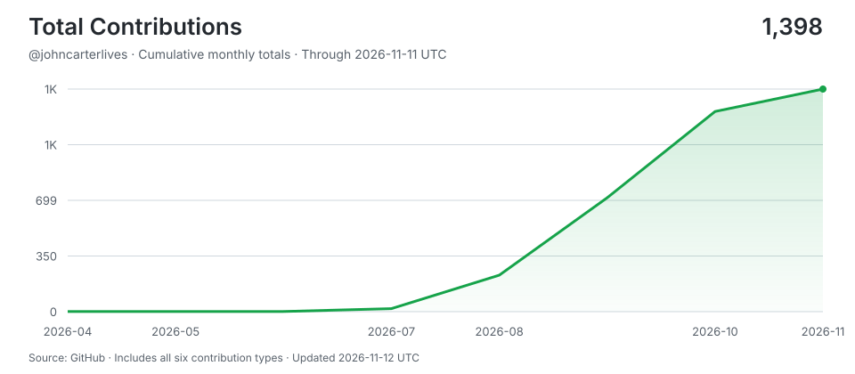

# johncarterlives

> Shipping with AI agents around the clock -- human hours for thinking, machine hours for doing.
>
> Stats auto-updated by [aidevops](https://aidevops.sh).

<!-- STATS-START -->
## Work with AI

| Metric | Yesterday | Prior 7 Days | Prior 28 Days | Prior 365 Days |
| --- | ---: | ---: | ---: | ---: |
| Screen time (Mac) | 24h | 58.7h | 331.4h | ~3285h* |
| Input activity (Mac) | unavailable | unavailable | unavailable | unavailable |
| Interactive human attention | 11.4h | 26.9h | 144.0h | 464.2h |
| Interactive AI generation | 21.9h | 83.8h | 339.3h | 1043.3h |
| Worker-classified human attention | 0.1h | 0.1h | 7.1h | 128.8h |
| Worker/headless AI generation | 1.5h | 19.0h | 95.2h | 315.0h |
| Additive observed work | 34.8h | 129.6h | 582.2h | 1,908.4h |
| Interactive sessions | 604 | 1,108 | 1,277 | 1,981 |
| Worker sessions | 134 | 986 | 4,151 | 9,352 |

_Screen time from screen-time-history:daily-observations; collection status: ok. *365-day estimate uses observed calendar coverage._

_Input activity from macos-input-activity (time from each keyboard, mouse or trackpad input until 5 idle minutes); collection status: unavailable (no-input-activity-samples)._

_Periods are completed local calendar days ending at midnight; today is excluded._

_Human attention is unioned wall-clock time, so overlapping sessions are not double-counted. AI generation is additive machine work across sessions; it is not wall-clock concurrency._

_AI session 365-day totals cover 218 days of local assistant session history (not extrapolated)._

## AI Model Usage (last 30 days)

| Model | Requests | Input | Output | Cache read | Cache write | Cache Hit-Rate % | Session Count | Session Hours |
| --- | ---: | ---: | ---: | ---: | ---: | ---: | ---: | ---: |
| claude-opus-5-5 | 29,742 | 63K | 12.5M | 4,744.0M | 231.7M | 95.3% | 395 | 167.1h |
| gpt-6.1-sol-fast | 20,689 | 69.9M | 5.8M | 3,036.9M | 0 | 97.7% | 79 | 159.5h |
| gpt-6.1-sol | 18,547 | 118.8M | 3.5M | 1,739.8M | 0 | 93.6% | 1,397 | 82.5h |
| gpt-6-luna | 7,718 | 170.3M | 2.4M | 541.9M | 0 | 76.1% | 2,392 | 27.7h |
| gpt-6-astra | 5,393 | 19.1M | 1.5M | 808.0M | 0 | 97.7% | 168 | 45.1h |
| claude-sonnet-5-5 | 970 | 18K | 1.0M | 39.4M | 21.4M | 64.7% | 550 | 11.4h |
| studio-glm-5.3-flash | 490 | 1.9M | 105K | 34.2M | 0 | 94.5% | 17 | 1.0h |
| claude-haiku-5-5 | 287 | 1K | 746K | 5.6M | 17.9M | 24.1% | 220 | 2.8h |
| claude-fable-5-2 | 65 | 140 | 76K | 9.7M | 983K | 90.8% | 2 | 0.4h |
| gpt-6-sol | 45 | 316K | 3K | 58K | 0 | 15.7% | 36 | 0.1h |
| gpt-5.6-luna | 43 | 947K | 7K | 5.6M | 0 | 85.6% | 5 | 0.1h |
| gpt-6-sol-fast | 9 | 206K | 4K | 1.6M | 0 | 88.8% | 1 | 0.0h |
| claude-sonnet-4-6 | 6 | 18 | 9K | 29K | 66K | 30.9% | 6 | 0.1h |
| **Total** | **84,004** | **381.8M** | **28.0M** | **10,967.2M** | **272.2M** | **94.4%** | **5,075** | **498.0h** |

_11,649.3M total tokens processed. 94.4% cache hit rate._

## AI Model Usage (all time)

| Model | Requests | Input | Output | Cache read | Cache write | Cache Hit-Rate % | Session Count | Session Hours |
| --- | ---: | ---: | ---: | ---: | ---: | ---: | ---: | ---: |
| gpt-5.6-sol | 54,086 | 245.8M | 12.5M | 7,425.8M | 0 | 96.8% | 519 | 440.4h |
| gpt-6.1-sol | 38,224 | 219.5M | 8.0M | 4,018.5M | 0 | 94.8% | 2,136 | 215.8h |
| claude-opus-5-5 | 29,742 | 63K | 12.5M | 4,744.0M | 231.7M | 95.3% | 395 | 167.1h |
| gpt-6.1-sol-fast | 24,017 | 82.9M | 6.8M | 3,558.6M | 0 | 97.7% | 94 | 194.1h |
| gpt-5.6-terra | 16,886 | 284.7M | 3.0M | 1,283.6M | 0 | 81.8% | 1,615 | 58.0h |
| gpt-6-luna | 13,153 | 295.0M | 3.6M | 958.1M | 0 | 76.5% | 3,937 | 47.3h |
| gpt-6-astra | 12,813 | 62.3M | 3.8M | 2,130.0M | 0 | 97.2% | 397 | 128.9h |
| gpt-5.5 | 7,076 | 45.3M | 2.0M | 717.6M | 0 | 94.1% | 127 | 33.4h |
| gpt-6-sol | 2,977 | 26.7M | 437K | 233.2M | 0 | 89.7% | 323 | 14.7h |
| gpt-5.6-luna | 2,180 | 46.4M | 530K | 186.8M | 0 | 80.1% | 471 | 31.8h |
| claude-sonnet-5-5 | 970 | 18K | 1.0M | 39.4M | 21.4M | 64.7% | 550 | 11.4h |
| studio-glm-5.3-flash | 490 | 1.9M | 105K | 34.2M | 0 | 94.5% | 17 | 1.0h |
| claude-haiku-5-5 | 287 | 1K | 746K | 5.6M | 17.9M | 24.1% | 220 | 2.8h |
| gemma4:26b-mlx | 82 | 4.1M | 26K | 0 | 0 | 0.0% | 5 | 1.1h |
| claude-fable-5-2 | 65 | 140 | 76K | 9.7M | 983K | 90.8% | 2 | 0.4h |
| muse-spark-1.3-contributor-free | 63 | 906K | 23K | 7.6M | 0 | 89.4% | 3 | 0.2h |
| big-pickle | 44 | 257K | 15K | 3.0M | 0 | 92.3% | 3 | 0.2h |
| qwen3.8-flash | 22 | 87K | 2K | 1.3M | 0 | 93.9% | 1 | 0.1h |
| gemma4-agent | 17 | 314K | 4K | 0 | 0 | 0.0% | 2 | 0.1h |
| gpt-6-sol-fast | 9 | 206K | 4K | 1.6M | 0 | 88.8% | 1 | 0.0h |
| Qwen3.8-27B-oQ6e-mtp:qwen38-q6-stable | 7 | 63K | 1K | 249K | 0 | 79.7% | 1 | 0.3h |
| claude-sonnet-4-6 | 6 | 18 | 9K | 29K | 66K | 30.9% | 6 | 0.1h |
| gemma4-agent-mlx:latest | 6 | 170K | 3K | 0 | 0 | 0.0% | 2 | 0.1h |
| mtplx-qwen38-27b-optimized-quality | 1 | 0 | 0 | 0 | 0 | 0.0% | 1 | 0.0h |
| nemotron-3.5-lightning-30b-a3b | 1 | 49K | 107 | 0 | 0 | 0.0% | 1 | 0.0h |
| qwen/qwen3.8-flash | 1 | 0 | 0 | 0 | 0 | 0.0% | 1 | 0.0h |
| **Total** | **203,225** | **1,317.3M** | **55.7M** | **25,359.8M** | **272.2M** | **94.1%** | **10,458** | **1,349.4h** |

_27,005.1M total tokens processed. 94.1% cache hit rate._
<!-- STATS-END -->

<!-- CONTRIBUTIONS-START -->
## Contributions

- **[aidevops](https://github.com/marcusquinn/aidevops)** -- Vibe-Coding is easy. DevOps is hard. OpenCode & Git token-efficient AI agent automation for your app, business, and personal development. Opinionated tools, services, CLI & API stack for speed, security, and 24/7 results. Open-source first. SOTA everything. Try on your repos for money-making magic.
- **[opendesk](https://github.com/useopendesk/opendesk)** -- The open-source support inbox + live chat and inbox collaboration for teams
- **[playwriter](https://github.com/remorses/playwriter)** -- Chrome extension & CLI to let agents control your browser. Runs Playwright snippets in a stateful sandbox. Available as CLI or MCP
<!-- CONTRIBUTIONS-END -->

## Connect

---

<!-- UPDATED-START -->
_Stats auto-updated 2026-11-12 08:52 UTC by [aidevops](https://aidevops.sh) pulse._
<!-- UPDATED-END -->

<!-- TOTAL-CONTRIBUTIONS-START -->

  <a href="https://commit-history.com/johncarterlives?metric=total" target="_blank" rel="noopener noreferrer">
    <picture>
      <source media="(prefers-color-scheme: dark)" srcset="assets/contributions/total-dark.svg" />
      
    </picture>
  </a>

[Verify on commit-history.com](https://commit-history.com/johncarterlives?metric=total) · [Chart data](assets/contributions/total.json)

Includes commits, issues, pull requests, reviews, repositories, and restricted contributions. Refreshed daily through the prior UTC day; commit-history.com may use a different refresh cutoff. GitHub controls link navigation—Ctrl/Cmd-click opens verification in a new tab.
<!-- TOTAL-CONTRIBUTIONS-END -->
